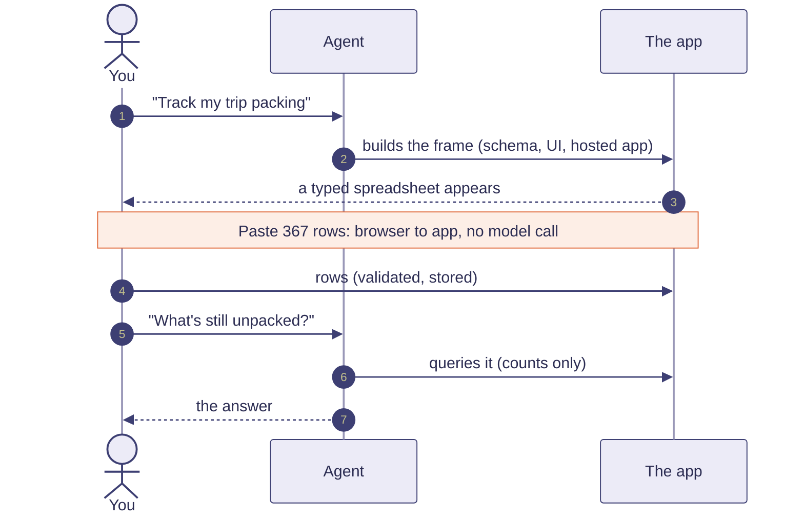

# Workbench

**The agent sets the frame. People fill it. The model stays out of the way.**

Describe a tracker in plain words. An agent builds it, hosts it in an isolated runtime and shows it in a
spreadsheet-like canvas. You then type or paste straight into the app, and **the model is not in that path**: pasting
367 rows costs zero tokens. When you want a judgment call ("what's overdue, and who owns the most?"), the agent
queries what you entered and answers in counts, findings and charts.

> This is a **spike** that demonstrates an architecture. It is not a product. See
> [what it is and is not](#what-this-is-not).



## Why this exists

In most agent UIs every keystroke becomes a prompt: paste 300 rows and the model reads all 300, then writes them
back out. That costs tokens, makes typing speed equal generation speed, puts everything people type into prompt
material, and models make mediocre photocopiers.

Workbench splits the work along two planes:

| Plane | Carries | Model involved? |
|---|---|---|
| **Control** | intent, schema, UI spec, tool calls, aggregates | yes |
| **Data** | rows, files, streams people enter | no |

[`docs/architecture.md`](docs/architecture.md) has the longer version, including the four "doors" where identity,
policy and audit would attach.

## What you can do with it

- **Ask for a tracker** and get a typed, hosted spreadsheet: dates with a picker, controlled status lists, validated
  numbers, paste from Excel or Sheets.
- **Ask a question of your data** and get counts back, not rows in a prompt.
- **Ask for an analysis** and get a dashboard of findings with the chart that proves each. The agent can read
  SQLite, DuckDB, Parquet, CSV and JSON files in your home.
- **Ask for a whole app** (a pomodoro clock that keeps its stats, a small game) and it is hosted on its own address
  and shown as a tab.
- **Close the laptop** and come back: sessions, history and files are persisted, and an expired runtime resumes
  with one click.

## Quick start

You need Docker, minikube, kubectl, [uv](https://docs.astral.sh/uv/), Node 20+, `make`, and an OpenAI-compatible
chat endpoint that supports tool calling. The full walkthrough, with troubleshooting, is in
**[`docs/getting-started.md`](docs/getting-started.md)**. The short version:

```bash
# 1. the cluster and the runtime server (repository: workbench-sandbox)
cd workbench-sandbox
./scripts/local-up.sh              # minikube + ingress + gVisor + images + deploy
minikube tunnel                    # separate terminal, leave it running

# 2. the agent and the UI (this repository)
cd ../workbench
cp .env.example .env               # set LLM_BASE_URL, LLM_MODEL, LLM_API_KEY
make install
make dev-agent                     # terminal A  -> :8000
make dev-frontend                  # terminal B  -> http://localhost:3000
```

Open <http://localhost:3000> and ask for something.

## How it fits together

```mermaid
%%{init: {"theme":"base","themeVariables":{"fontFamily":"Poppins, ui-sans-serif, system-ui, sans-serif","fontSize":"15px","primaryColor":"#ecebf7","primaryBorderColor":"#3d3f73","primaryTextColor":"#2b2c52","lineColor":"#3d3f73","secondaryColor":"#fdeee6","tertiaryColor":"#f7f6fb","clusterBkg":"#faf9fc","clusterBorder":"#cfcbe0","actorBkg":"#ecebf7","actorBorder":"#3d3f73","actorTextColor":"#2b2c52","actorLineColor":"#9a98b8","signalColor":"#3d3f73","signalTextColor":"#2b2c52","noteBkgColor":"#fdeee6","noteBorderColor":"#e0693a","noteTextColor":"#2b2c52"}}}%%
flowchart LR
    subgraph Browser
        chat["Chat<br/>CopilotKit"]
        canvas["Canvas<br/>sheet · dashboard · app tabs"]
    end
    subgraph Agent_service["Agent service · FastAPI :8000"]
        agent["Agent<br/>deepagents · skills · guards"]
        gw["App gateway<br/>/apps/*"]
    end
    subgraph Cluster["Kubernetes · workbench-sandbox"]
        mcp["MCP server<br/>one door for every action"]
        subgraph Runtime["Isolated runtime · one per session"]
            app["The app"]
            store[("Structured store")]
        end
        home[("Durable home<br/>PVC or S3 prefix")]
    end
    chat -- "AG-UI stream" --> agent
    agent -- "MCP tools" --> mcp
    mcp -- "create · run · expose" --> app
    canvas -- "rows · files" --> gw
    gw -- "token added server-side" --> app
    app --> store
    store <-- "sync" --> home
    classDef ctl fill:#ecebf7,stroke:#3d3f73,stroke-width:2px,color:#2b2c52;
    classDef data fill:#fdeee6,stroke:#e0693a,stroke-width:2px,color:#2b2c52;
    class chat,agent,mcp ctl;
    class canvas,gw,app,store,home data;
    linkStyle 3,4,5,6 stroke:#e0693a,stroke-width:3px;
```



- **Agent** (`src/sandbox_agent/agent/`): a [deepagents](https://github.com/langchain-ai/deepagents) agent, with
  guards that keep it honest: one runtime per session, per-run call limits, an empty-turn retry, and a
  redirect when it points a framework file tool at a sandbox path.
- **Skills** (`.../agent/skills/`): `micro-apps` (build and host record apps from a template configured by a small
  `fields.json`) and `data-wrangler` (query files and render dashboards).
- **UI specs** (`apps/spec.py` ↔ `frontend/lib/uiSpec.ts`): `sheet`, `table`, `form`, `metrics`, `dashboard`,
  `iframe`. The frontend has one component per kind and no per-app code.
- **Chat history**: SQLite on the agent service, so it survives a browser or process restart.

## Configuration

Environment only (a `.env` in the working directory is read too).

| Variable | Meaning | Default |
|---|---|---|
| `LLM_BASE_URL`, `LLM_MODEL` | OpenAI-compatible chat endpoint and model | required |
| `LLM_API_KEY` or `LLM_API_KEY_FILE` | the key, or a file containing it | required |
| `SANDBOX_MCP_URL` | the runtime server | `http://mcp.sandbox.localhost/mcp` |
| `SANDBOX_USER_ID` | the tenant whose home every session mounts. Keep it fixed: a new id is a new, empty home | `local-user` |
| `SANDBOX_AGENT_DATA_DIR` | where chat state lives (`threads.sqlite`, `sessions.sqlite`) | `./data` |
| `AGENT_DELEGATE` | `true` to split work into builder/debugger subagents | `false` |
| `AGENT_BASE_URL` | frontend → agent | `http://localhost:8000` |

Missing model settings fail at startup with a message naming each one.

## Tests

```bash
make test    # pytest (no cluster, no model needed) + tsc
make e2e     # a Playwright journey against the running stack (uses the real model)
```

## Repository layout

```
src/sandbox_agent/
  agent/        deep agent, prompt, guards, skills/
  apps/         UI specs, publish_app, show_dashboard
  api/          FastAPI app, browser→app gateway, sessions and history
frontend/       Next.js UI: chat, canvas tabs, sheet grid, dashboards, file browser
docs/           getting-started.md, architecture.md
tests/          unit tests (no cluster, no model)
```

## What this is not

- **Not a product.** Identity is a configured tenant id, not SSO. There is no audit log, and runtimes can reach the
  open internet. Those are the places the architecture says to attach to, not features that exist.
- **Not a security boundary you should trust as is.** Runtimes are gVisor pods with resource limits. Review
  everything before running it near data you care about.
- **Not tied to one model.** It was exercised with open-weight models behind an OpenAI-compatible gateway; behaviour
  varies with model strength.

## Related

[`workbench-sandbox`](https://github.com/jayrcaraan/workbench-sandbox) is the other half: the MCP server that creates isolated runtimes,
hosts the apps and keeps the durable home.

## License

Apache-2.0. See [LICENSE](LICENSE).
