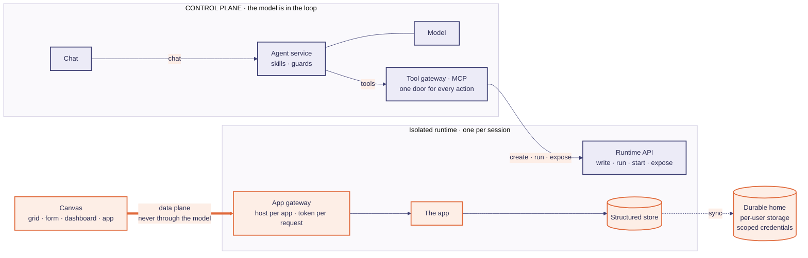

# Architecture

Workbench is a spike built to demonstrate one idea:

> **Let the model own the control plane. Keep people's data on the data plane.**

An agent is good at deciding structure: a schema, an interface, where something should live. It is a poor and
expensive place to route a few hundred rows someone is typing in. So the agent builds the frame, then steps aside.

## Three moves

| | Who works | What happens |
|---|---|---|
| **1. Frame** | the model | Understands the request, writes the field definitions, starts an app in an isolated runtime, checks that it answers, publishes a UI for it |
| **2. Fill** | people, not the model | Type or paste into the app. Rows go from the browser to the app, validated against typed columns, stored as structured data |
| **3. Follow up** | the model | Queries what was entered and answers in counts, findings and charts |

## Two planes

Navy is where the model works. Peach is where people's data travels, and the model never sees it.

## Four doors

Everything an agent does and everything a person does crosses one of four places. That is where identity,
policy and audit belong, and why they are not smeared across the agent.

| # | Door | What crosses it | In this spike | Where more would attach |
|---|---|---|---|---|
| 1 | Tool gateway (MCP server) | every action the agent takes | one endpoint; sandbox tokens redacted from tool output; one sandbox per session | policy, approvals, audit |
| 2 | App gateway (Caddy + ingress) | every request to every app | a host per app, token checked per request | SSO, access logs, egress rules |
| 3 | Storage layer | every byte of user data | per-user prefix, short-lived scoped credentials | retention, encryption, DLP |
| 4 | The data path | what people type and paste | typed columns, validated server side | classification, field rules |

## Declarative first, code in a cage

The default apps are rendered from a **spec** by trusted code in the frontend (sheet, table, form, metrics,
dashboard). The model emits JSON; it does not ship script into the page. Custom code is the exception, and it
runs inside the isolated runtime and is shown as an iframe on its own origin.

## What the model sees

| Sees | Does not see |
|---|---|
| the user's request | the rows people entered |
| the schema and the UI spec it wrote | sandbox tokens, storage credentials |
| small aggregates it asked for (so it can describe them honestly) | other users' files |
| tool errors | anything pasted into a grid |

## Where things are in the code

| Concept | Code |
|---|---|
| The agent, its middleware and guards | `src/sandbox_agent/agent/` (`build.py`, `filetools.py`, `retry.py`, `limits.py`, `session.py`) |
| Skills the agent reads | `src/sandbox_agent/agent/skills/{micro-apps,data-wrangler}/` |
| Record-app template and the sheet collector | `.../skills/micro-apps/references/` |
| Publishing an app / a dashboard | `src/sandbox_agent/apps/` (`publish.py`, `data.py`, `spec.py`) |
| The browser to app gateway | `src/sandbox_agent/api/proxy.py` |
| Chat history and sessions (SQLite) | `src/sandbox_agent/api/history.py`, `sessions.py` |
| Spreadsheet grid, dashboards, tabs | `frontend/components/` |

The runtime side (MCP tools, pods, the app gateway config, storage adapters, the TTL reaper) lives in the
sibling repository, `workbench-sandbox`.

## Honest limits

This is a working spike, not a product. Identity is a configured tenant id, not SSO. There is no audit log yet,
and runtimes can reach the open internet. Those are the places the design says to attach to, not features that exist.
