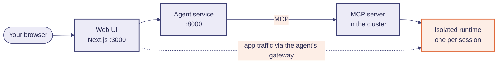

# Run it on your laptop

This guide takes you from nothing to a working Workbench on a single machine. It covers **both** repositories:

| Repo | What runs there |
|---|---|
| `workbench` (this one) | the agent service, the web UI, the skills |
| `workbench-sandbox` | the MCP server that creates isolated runtimes, hosts the apps and keeps the durable home |

Plan on about **20 minutes** the first time, most of it image builds and downloads.



## 0. What you need

| Tool | Version | Why |
|---|---|---|
| Docker (Desktop or Engine) | recent | minikube runs the cluster in it, and you build two images |
| minikube | 1.32+ (tested on 1.39) | the local Kubernetes cluster |
| kubectl | matches the cluster | |
| [uv](https://docs.astral.sh/uv/) | any recent | Python environment for the agent service and the MCP server |
| Node.js | 20+ | the web UI |
| make | any | the targets below |
| A chat model endpoint | OpenAI-compatible, with **tool calling** | the agent's brain |

Give Docker about **6 GB of RAM and 4 CPUs**. Each sandbox is limited to 2 CPUs and 4 GiB by default.

**About the model.** Any OpenAI-compatible `chat/completions` endpoint that supports tool calls should work. The
spike was developed against Databricks AI Gateway serving open-weight models (Qwen3.5-122B and gpt-oss-120b).
Smaller models tend to stall on multi-step builds; if the agent loops or gives up, try a stronger model first.

## 1. Get both repositories side by side

```bash
mkdir workbench-stack && cd workbench-stack
git clone <url-of-workbench>          workbench
git clone <url-of-workbench-sandbox>  workbench-sandbox
```

## 2. Start the cluster

```bash
cd workbench-sandbox
minikube start --driver=docker --container-runtime=containerd --cpus=4 --memory=6144
minikube addons enable ingress
minikube addons enable gvisor        # optional but recommended: the isolation layer
kubectl get runtimeclass             # should list "gvisor"
```

`gvisor` needs the `containerd` runtime, which is why it is in the `start` command. No gVisor on your machine
(another distribution, or you would rather skip it)? Skip the addon and see
[Running without gVisor](#running-without-gvisor).

## 3. Build the two images and deploy

```bash
make build           # the MCP server image, loaded into minikube
make build-sandbox   # the runtime image every sandbox starts from (Python, Node, Caddy, data libraries)
make deploy-local    # namespace, RBAC, the server, and its ingress
kubectl -n sandbox-system get pods     # sandbox-mcp should be Running
```

There is also a single command that does steps 2 and 3 for you: `./scripts/local-up.sh`.

## 4. Make `*.sandbox.localhost` reachable

Every app gets its own host name like `tracker.sbx-1a2b3c4d.sandbox.localhost`. `*.localhost` already resolves
to `127.0.0.1` on macOS and most browsers; what is missing is a path from port 80 on your machine to the
cluster's ingress. In a **separate terminal**, leave this running:

```bash
minikube tunnel         # asks for your password: it binds port 80
```

Check it:

```bash
curl -i http://mcp.sandbox.localhost/healthz      # expect HTTP 200
```

On Linux, if `*.localhost` does not resolve for `curl`, add a resolver rule for it (for example a `dnsmasq`
line `address=/localhost/127.0.0.1`), or put the host names you use in `/etc/hosts`.

## 5. Start the agent and the UI

```bash
cd ../workbench
cp .env.example .env
```

Edit `.env` and set the three model values:

```bash
LLM_BASE_URL=https://<your-endpoint>/v1
LLM_MODEL=<model name>
LLM_API_KEY=<key>            # or LLM_API_KEY_FILE=path/to/a/file
```

Then, in two terminals:

```bash
make install        # uv sync, plus npm install for the UI
make dev-agent      # terminal 1: the agent service on :8000
make dev-frontend   # terminal 2: the UI on http://localhost:3000
```

## 6. Try it

Open <http://localhost:3000>. A sandbox starts for your session by itself (the rail on the left shows its id).
Then ask for something. Good first prompts:

1. *"I'm tracking packing for a business trip. Build me a checklist with item, category and packed, stored in a
   SQLite file. Use a spreadsheet-like view."*
2. Paste a few dozen rows into the grid from a spreadsheet. Watch the chat: nothing happens, which is the point.
3. *"Which items are still unpacked, by category? Counts only."*
4. *"Dig into this data like an analyst. Three findings, a chart for each."*
5. *"Build and host a small pomodoro clock that keeps daily stats."* It appears as its own tab.

Open the **Files** tab on the left to see the durable home, or start a **New session** and notice that its
fresh sandbox sees the same files.

## Running without gVisor

gVisor is an isolation layer, not a requirement for the concept to work. To run on a cluster without it, set the
runtime class to empty so pods use the cluster default:

```bash
kubectl -n sandbox-system set env deploy/sandbox-mcp RUNTIME_CLASS=
```

Understand what you give up: runtimes are still separate pods with resource limits, but without the extra
syscall isolation. Treat a no-gVisor setup as a development convenience.

## Optional: keep the home volume in S3

By default each user's home is a PersistentVolumeClaim. To use an S3-compatible bucket instead (with
short-lived credentials scoped to the user's prefix), use RustFS (or MinIO) in the cluster:

```bash
cd ../workbench-sandbox
kubectl -n sandbox-system create secret generic s3-credentials \
  --from-literal=AWS_ACCESS_KEY_ID=<choose-a-key> \
  --from-literal=AWS_SECRET_ACCESS_KEY=<choose-a-secret>
kubectl apply -f deploy/k8s/examples/05-rustfs.yaml
kubectl apply -f deploy/k8s/examples/04-mcp-s3.yaml
```

That runs a second MCP server at `mcp-s3.sandbox.localhost`. Point the agent at it in `.env`:

```bash
SANDBOX_MCP_URL=http://mcp-s3.sandbox.localhost/mcp
```

The RustFS example stores data in an `emptyDir`, so it is lost when that pod restarts. Fine for a laptop; mount a
volume for anything you want to keep.

## When something is off

| You see | Likely cause and fix |
|---|---|
| `curl mcp.sandbox.localhost/healthz` hangs or fails | `minikube tunnel` is not running, or not as root. Restart it. |
| The UI says the sandbox cannot start; pod is `ImagePullBackOff` | The runtime image is not in the cluster: run `make build-sandbox`, then `minikube image ls \| grep sandbox`. |
| `RuntimeClass "gvisor" not found` | The addon is not enabled. `minikube addons enable gvisor`, or [run without it](#running-without-gvisor). |
| The agent errors with 401, 403 or 404 at startup of a run | `LLM_BASE_URL`, `LLM_MODEL` or the key is wrong. The agent names each missing setting at startup. |
| It starts well, then loops or stops after a few steps | The model is struggling with tool calls. Try a stronger model. Rate limits (429) are retried automatically. |
| An app opens but is blank in an iframe tab | Open it with **Open in new tab** and read the browser console. Apps must bind `0.0.0.0` and a port other than 8080 or 2019. |
| Everything worked yesterday and nothing does today | Sandboxes expire (60 minutes by default). Open the session and press **Resume**; the files are still in your home. |

## Clean up

```bash
# stop the two dev processes with Ctrl-C, stop minikube tunnel, then:
minikube delete        # removes the cluster and all data in it
```
